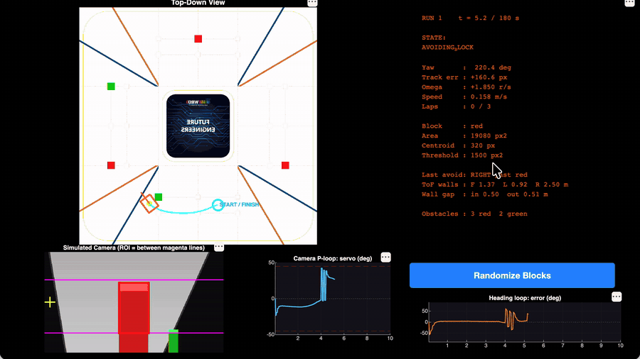
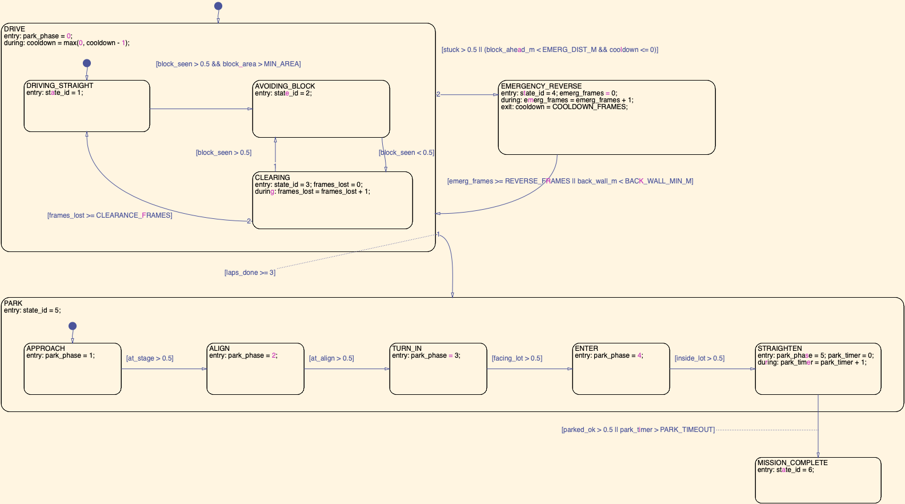
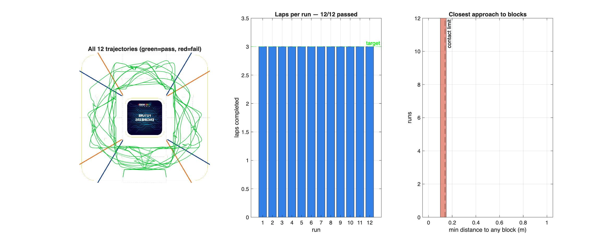
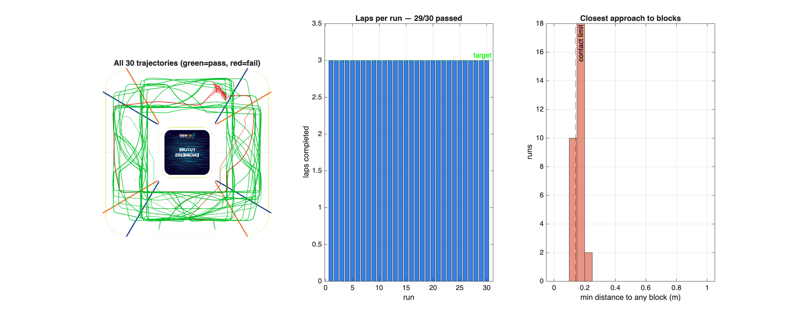
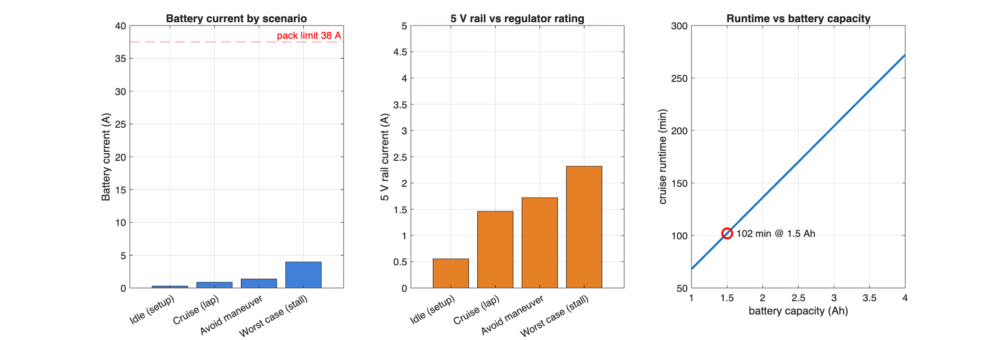
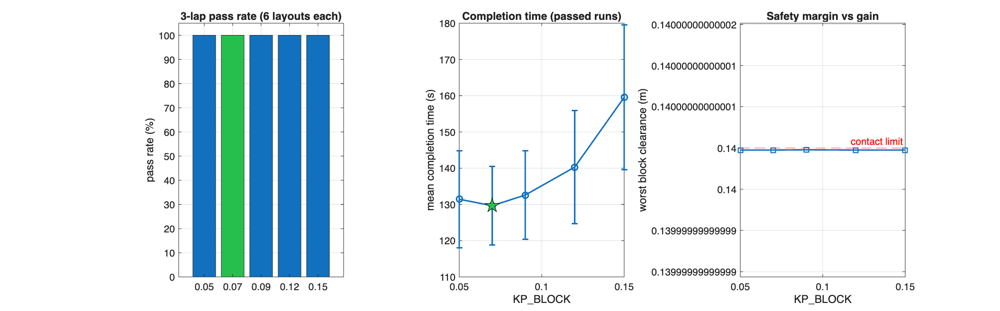
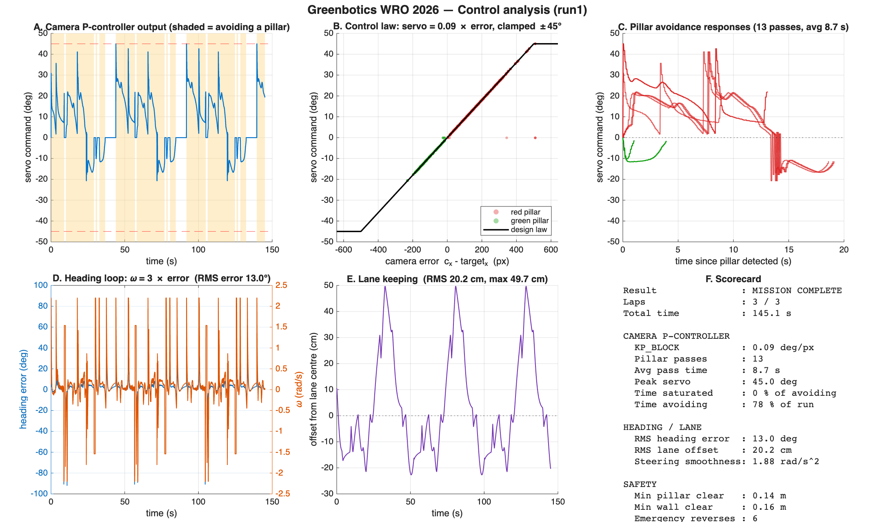

# MATLAB Simulation Report — Obstacle Challenge

[](simulation_demo.mp4)

*The simulator on two officially randomized layouts, with the control analysis
saved after each run. Click the preview for the full video (29 s).*

## Rubric Guide

Where each part of the MathWorks Modeling Award 2026 rubric is answered in this
report:

| Rubric section (points) | Where to find it |
|---|---|
| Problem context and strategy (5) | [Problem Statement](#problem-statement), [Project Objectives](#project-objectives), [Why MATLAB, and Which Products](#why-matlab-and-which-products) |
| Innovation and modeling (5) | [Simulation Architecture](#simulation-architecture), [Perception](#perception-vision-pipeline-kept-in-sync), [Navigation and State Machine](#navigation-and-state-machine), [Stateflow Model](#stateflow-model-of-the-state-machine), [Official WRO Randomization](#official-wro-randomization), [Full Mission](#full-mission-parking-and-both-directions), [Power Budget](#power-budget-prediction--measurement--verification) |
| Test and verification (5) | [Validation Results](#validation-results), [Engineering Iterations](#engineering-iterations), [Closing the Loop](#closing-the-loop-simulation-tuned-parameters), [Control Analysis](#control-analysis-inside-the-steering-loops), [Sim-to-Real](#sim-to-real-what-the-timing-does-and-doesnt-validate), [Deployment](#deployment-what-actually-reached-the-robot) |
| Code quality and readability (3) | [Simulation Architecture](#simulation-architecture) (module table), [How to Run](#how-to-run), code in [`obstacle_challenge/`](obstacle_challenge/) |
| Report quality and product feedback (2) | [Lessons Learned and Product Feedback](#lessons-learned-and-product-feedback), [Known Limitations](#known-limitations), [Conclusion](#conclusion) |

| Required README content (2026) | Where to find it |
|---|---|
| 1. Brief introduction to the problem | [Problem Statement](#problem-statement) |
| 2. The solution and how MATLAB was used | [Simulation Architecture](#simulation-architecture), [Why MATLAB, and Which Products](#why-matlab-and-which-products) |
| 3. Link to the model and relevant files | All MATLAB code: [`obstacle_challenge/`](obstacle_challenge/); entry point [`run.m`](obstacle_challenge/run.m); batch test [`evaluate.m`](obstacle_challenge/evaluate.m). Simulink/Stateflow model: [`stateflow/greenbotics_state_machine.slx`](stateflow/greenbotics_state_machine.slx), built and tested by [`build_state_machine.m`](stateflow/build_state_machine.m) |
| 4. Testing, deployment and how results were evaluated | [Validation Results](#validation-results), [Sim-to-Real](#sim-to-real-what-the-timing-does-and-doesnt-validate), [Deployment](#deployment-what-actually-reached-the-robot) |
| 5. Achievements, lessons learned, reflections on MathWorks tools | [Conclusion](#conclusion), [Lessons Learned and Product Feedback](#lessons-learned-and-product-feedback) |

## Evidence at a Glance

Every number in this report, and what kind of evidence it is:

| Result | Value | Evidence type | Details |
|---|---|---|---|
| Missions on 12 randomized layouts (`'field'` mode, seed 42) | 12/12 complete, 12/12 full parks, 0 barrier touches, min sign clearance 0.14 m | Simulated | [Validation Results](#validation-results) |
| Missions in `'gyro'` mode (robot's real architecture), 12 layouts, seed 42 | 12/12 complete, 12/12 full parks, 0 barrier touches | Simulated (development set) | [Validation Results](#gyro-mode-the-robots-own-architecture) |
| `'gyro'` mode, 30 layouts, seed 7 | 30/30 complete, 30/30 full parks, 0 barrier touches | Simulated (development set) | [Validation Results](#gyro-mode-the-robots-own-architecture) |
| `'gyro'` mode, 30 held-out layouts, seed 2026 (never used while tuning) | 29/30 complete, 29/30 full parks, 0 barrier touches | Simulated (held-out test) | [Validation Results](#gyro-mode-the-robots-own-architecture) |
| Stateflow chart vs scripted scenario | 14/14 expected transitions pass | Simulated (Stateflow) | [Stateflow Model](#stateflow-model-of-the-state-machine) |
| Average simulated mission time | 148.2 s | Simulated (not real-world time) | [Sim-to-Real](#sim-to-real-what-the-timing-does-and-doesnt-validate) |
| Steering-gain sweep (`KP_BLOCK`, `'field'` mode) | Flat optimum 0.05–0.09; ≥ 0.12 costs up to +20% time | Simulated, not deployed | [Closing the Loop](#closing-the-loop-simulation-tuned-parameters) |
| Pi power under full vision load | 5.7 W | Measured (PMIC) | [Power Budget](#power-budget-prediction--measurement--verification) |
| Steering servo stall current | ~0.8 A | Measured | [Power Budget](#power-budget-prediction--measurement--verification) |
| Whole-robot battery current | 0.40 A idle / 0.80 A driving | Measured | [Power Budget](#power-budget-prediction--measurement--verification) |
| Power model vs multimeter at cruise | Within 10% | Model checked against measurement | [Power Budget](#power-budget-prediction--measurement--verification) |
| Peak 5 V demand | 2.3 A against a 5 A regulator (2.2× headroom) | Model, validated at cruise | [Power Budget](#power-budget-prediction--measurement--verification) |
| Runtime on 1500 mAh 3S pack | ~102 min | Model | [Power Budget](#power-budget-prediction--measurement--verification) |
| Worst-case servo stall | 44 W, 2.6 C | Model only (not safe to measure) | [Power Budget](#power-budget-prediction--measurement--verification) |
| Real robot obstacle run | 45 s at deployed cruise speed | Measured on the robot | [Sim-to-Real](#sim-to-real-what-the-timing-does-and-doesnt-validate) |
| Gyro PD gains in `'gyro'` mode | KP 0.85, KD 0.1 | Copied from robot code (`tuning.py`) | [Deployment](#deployment-what-actually-reached-the-robot) |
| Simulated camera | No noise, blur or lighting variation | Assumption | [Known Limitations](#known-limitations) |
| Simulated HSV thresholds | Adapted to the renderer, not the robot's values | Assumption | [Perception](#perception-vision-pipeline-kept-in-sync) |
| Simulated cruise speed | 0.18 m/s nominal | Assumption, chosen for controller stability | [Sim-to-Real](#sim-to-real-what-the-timing-does-and-doesnt-validate) |

## Table of Contents
- [Rubric Guide](#rubric-guide)
- [Evidence at a Glance](#evidence-at-a-glance)
- [Problem Statement](#problem-statement)
- [Project Objectives](#project-objectives)
- [Simulation Architecture](#simulation-architecture)
- [Perception: Vision Pipeline, Kept in Sync](#perception-vision-pipeline-kept-in-sync)
- [Navigation and State Machine](#navigation-and-state-machine)
- [Stateflow Model of the State Machine](#stateflow-model-of-the-state-machine)
- [Official WRO Randomization](#official-wro-randomization)
- [Full Mission: Parking and Both Directions](#full-mission-parking-and-both-directions)
- [Engineering Iterations](#engineering-iterations)
- [Validation Results](#validation-results)
- [Power Budget: Prediction → Measurement → Verification](#power-budget-prediction--measurement--verification)
- [Closing the Loop: Simulation-Tuned Parameters](#closing-the-loop-simulation-tuned-parameters)
- [Control Analysis: Inside the Steering Loops](#control-analysis-inside-the-steering-loops)
- [Why MATLAB, and Which Products](#why-matlab-and-which-products)
- [Sim-to-Real: What the Timing Does and Doesn't Validate](#sim-to-real-what-the-timing-does-and-doesnt-validate)
- [Deployment: What Actually Reached the Robot](#deployment-what-actually-reached-the-robot)
- [Lessons Learned and Product Feedback](#lessons-learned-and-product-feedback)
- [How to Run](#how-to-run)
- [Known Limitations](#known-limitations)
- [Conclusion](#conclusion)

---

## Problem Statement

Testing robot navigation on the physical WRO arena is slow, unrepeatable, and
risky. The Obstacle Challenge randomizes the traffic-sign layout **before every
round** (coin tosses + 36 official cards), so a strategy that works on one
layout can fail on the next — and physically rebuilding dozens of layouts to
test one code change is impractical. Every crash also risks the steering servo
and camera mount.

Our answer is a MATLAB **simulation**: a virtual arena where our robot's
actual perception strategy runs in closed loop — perception → decision →
actuation → physics → perception — every test layout is generated by the
official randomization procedure, and performance is measured in numbers
instead of impressions. Unlike a scripted visualization, a closed-loop simulation
can *fail*, and it fails exactly where our algorithm is weak: that is the
point of simulating.

## Project Objectives

1. Reproduce the field to official dimensions: 3×3 m mat, 1×1 m centre box,
   sign seats at the exact card positions (rows 400/600 mm from the outer wall).
2. Run our robot's **vision *method*** (two-range HSV hue-wrap detection,
   portrait-shape filtering) against a simulated camera, and separately model
   its **current navigation architecture** (gyro-PD heading lock, discrete
   corner turns, red-right/green-left pillar passing) — see
   [Perception](#perception-vision-pipeline-kept-in-sync) for exactly what is
   and isn't a literal port of `src/obstacle_challenge/`.
3. Generate every test layout with the **official randomization procedure**.
4. Complete the full mission — **3 laps + parallel parking** — in both driving
   directions, without touching walls, signs, or parking barriers.
5. Measure everything and validate statistically over batches of layouts.
6. Analyse the steering as a control system: log both loops every step and
   check that the controller behaves as designed, run by run.

## Simulation Architecture

One shared control step is used by both the interactive simulator and the
headless batch evaluator, so the two can never drift apart.

| Module | Role | Real-robot counterpart |
|---|---|---|
| `run.m` | Interactive sim: live map, simulated camera, telemetry, live control graphs, Randomize button | debug UI |
| `run_video.m` | Same sim in demo mode (CCW, no parking, 3 laps + stop at start) | — |
| `save_control_report.m` | 6-panel control-loop analysis after every run | journal / tuning evidence |
| `control_step.m` | One 30 Hz perception + decision + physics step | main control loop |
| `render_frame.m` | Simulated 640×360 camera: walls, pillars, magenta barriers | Picamera2 |
| `find_biggest_block.m` | ROI crop → HSV masks → largest portrait blob | camera module |
| `ray_wall_distance.m` | Ray-cast wall distances | VL53 ToF sensors |
| `place_obstacles_random.m` | Official coin + 36-card randomization | judges' procedure |
| `parking_control.m` | Post-lap-3 parking maneuver | parking routine |
| `simulate_run.m` / `evaluate.m` | Headless runs / batch statistics | test harness |
| `sweep_kp.m` | Steering-gain sweep on paired layouts | tunes `config.py` |
| `power_budget.m` | Electrical model: rails, battery, runtime | battery/regulator selection |

## Perception: Vision Pipeline, Kept in Sync

**Sync note (2026-11):** earlier revisions of this page claimed the simulated
pipeline was a line-by-line port of a file called `main_v3.py`. That file has
since been retired (it now lives under `src/obstacle_challenge/legacy/`); the
robot shipped `main_v4.py` and now `main.py`, and vision detection moved into
a shared `src/vision/pipeline.py` driven by `src/obstacle_challenge/tuning.py`.
We checked the claim against the current source and it no longer held, so this
section is rewritten to say exactly what is and isn't shared today.

**Shared with the current robot code:** the 640×360 frame size, the ROI-crop
approach, the two-range red hue-wrap split (0–10 and 170–180) for the HSV
path, and the portrait/upright shape filter that rejects reflections and lying
objects.

**Not shared (and why):** the exact numeric HSV bounds and minimum contour
area. `render_frame.m` paints pillars as flat, idealized colour
(`[215,30,30]` red, `[25,185,40]` green in RGB — saturated and bright), while
the robot's thresholds in `tuning.py` are calibrated per-venue against real
room lighting (and literally a different value range, e.g. red's V-upper is
180 there vs. the headroom this sim needs for its much brighter synthetic
pillars). Copying the real numbers in verbatim would make the simulated
camera blind to its own simulated pillars, so `config.m` keeps its own wider
thresholds — see the sync note at the top of that file for the exact real
values, kept there for traceability. The robot's current vision pipeline also
runs a white-balance colour-split step (`tuning.py`'s `COLOUR_SPLIT`) to tell
red pillars from magenta parking barriers under variable lighting, which has
no equivalent need in a simulated camera with fixed, distinguishable colours.

**Steering law — two modes, used honestly:**

- `'field'` mode (the simulation baseline used for the headline validation
  results below) steers with a simple proportional law, kept because it is a
  clean, well-behaved baseline for randomization/statistics work, not because
  it matches the robot:
  ```
  servo = clamp( KP_BLOCK × (cx − target_x), ±45° )
  red   → target_x = 20   (pass on its right)
  green → target_x = 620  (pass on its left)
  ```
- `'gyro'` mode models the robot's actual current navigation *architecture* —
  gyro-PD heading lock between corners (same gains as `control.py`'s
  `steer_with_gyro()`), discrete corner turns, and pillars passed red-right /
  green-left. Which pillar to deal with and how follows the intent of the
  robot's rule engine: only pillars on the current straight count
  (`_is_next_straight_pillar`), the nearest unpassed one is the target and
  hands over to the next once passed (`pick_target_block`), and the robot
  steers for the middle of the gap between the pillar and the wall on its
  side (`rule_red`/`rule_green`, `_gap_to_wall`). The rules themselves are not
  copied line for line: they work on camera-image geometry (handoff lines,
  wall areas) tuned to one physical camera mount, which has no direct
  equivalent in a top-down point-mass model. See
  `control_step_gyro.m`'s header for the complete, itemised list of what is
  and isn't a literal port.

## Navigation and State Machine

We evaluated two architectures and kept the one that survived testing:

- **Layered overrides (rejected):** track steering + wall repulsion + block
  avoidance added as separate corrections. Near a wall the corrections
  cancelled to zero and the robot deadlocked — observed repeatedly.
- **Unified vector field (final):** every influence is a direction vector and
  steering follows the summed direction. The lane-flow component always points
  along the track, so the resultant is never zero: the robot always has
  somewhere to go.

Block avoidance pulls toward a **pass point** 0.30 m beside each pillar,
anchored to the lane direction at the pillar (world frame). Our first version
anchored it to the robot's heading — the push direction rotated with the
robot and it orbited pillars in circles. World-frame anchoring made orbiting
geometrically impossible.

States: `DRIVING_STRAIGHT → AVOIDING_BLOCK → CLEARING → (back)`, with
`EMERGENCY_REVERSE` as a guarded last resort and a stuck watchdog (< 6 cm of
motion in 3 s forces a back-off) as the final safety net. This is the `'field'`
mode's architecture; `'gyro'` mode's corner trigger is a geometric proxy
(front-wall proximity while positioned in a corner square) for the real
robot's orange-line crossing trigger (`rules.py`'s `count_turns`) — floor
lines are not rendered in this simplified camera model, so line detection
itself is not simulated. How deep into the corner the robot drives before
turning depends on the first pillar of the next straight: deeper when it must
be passed on the outside, earlier when on the inside.

## Stateflow Model of the State Machine

The navigation decisions in `control_step.m` (`'field'` mode) and
`parking_control.m` are also built as an executable **Stateflow chart in
Simulink**: [`stateflow/greenbotics_state_machine.slx`](stateflow/greenbotics_state_machine.slx).



- **What it models:** the decision logic. DRIVE (DRIVING_STRAIGHT,
  AVOIDING_BLOCK, CLEARING), EMERGENCY_REVERSE, PARK (APPROACH, ALIGN,
  TURN_IN, ENTER, STRAIGHTEN) and MISSION_COMPLETE, with the same thresholds
  as the MATLAB simulator: 1500 px² pillar area to start avoiding, 45 frames
  without a pillar to stop clearing, 0.19 m emergency distance, 24 reverse
  frames, 45-frame cooldown, 150-frame parking timeout.
- **What it does not model:** physics, the camera or steering. Its 11 inputs
  are the values `control_step.m` computes each step (pillar seen, pillar
  area, distances, lap count, parking checkpoints).
- **How it was checked:** [`build_state_machine.m`](stateflow/build_state_machine.m)
  builds the model from code, runs a 14-second scripted scenario at 30 Hz
  and checks 14 expected transitions.
  Result: **14 / 14 pass** ([full output](stateflow/check_results.txt)).
  Transition timing matches the MATLAB simulator to within one 30 Hz frame.
- **What the chart makes explicit:** transition priorities that are only
  implied by the order of `if` statements in `control_step.m`. Finishing
  lap 3 is checked before an emergency reverse, and a pillar reappearing is
  checked before the clearing timeout.
- **Next step:** drive the chart with inputs logged from a full simulator run
  and compare the two state sequences step by step.

## Official WRO Randomization

`place_obstacles_random.m` implements the rulebook procedure, cross-checked
against the official randomization app: one coin-chosen section receives a
single sign at X2; the other three sections draw cards (never two signs on one
radius, X seats only as singles); at least one mixed-colour same-row pair is
guaranteed; seats in front of the start zone are excluded; the parking section
allows only inner-row seats. Every simulated round is a legal competition
layout — including the worst ones.

## Full Mission: Parking and Both Directions

- **Parking lot to rule:** two magenta barriers (200×20×100 mm) against the
  outer wall of the start section, gap = 1.5 × robot length. The barriers are
  solid physics objects, rendered by the simulated camera in magenta (outside
  the red/green HSV masks, so detection is unaffected), and **every touch is
  counted** — rule 9.24.7 ends a real round on contact.
- **Maneuver after lap 3:** approach → align on the lot → turn in → enter →
  straighten parallel. The verdict mirrors scoring: *full* (projection fully
  between the barriers + parallel + zero touches) or *partial*.
- **Both driving directions:** each round randomizes CW/CCW like the real
  competition; the start zone mirrors and the lot moves to the opposite half
  of the section.

## Engineering Iterations

Every design change was driven by an observed failure:

| # | Observed failure | Root cause | Fix |
|---|---|---|---|
| 1 | Endless left/right oscillation | Avoidance target ±180° from heading flipped the error sign every frame | Heading-relative targets; later replaced by vector field |
| 2 | Robot pinned against wall | Steering corrections cancelled to zero | Re-architecture: unified vector field |
| 3 | ~10 reverse cycles per sign | Reverse trigger too eager + avoidance turned back into the block's lane | Narrower trigger + cooldown + decaying push while clearing |
| 4 | Loop-the-loop circles at pillars | Heading-relative push rotates with the robot (orbit feedback) | World-frame pass points |
| 5 | Wedged between sign and outer wall | Wall repulsion covered the whole legal corridor | Repulsion range cut to 0.22 m |
| 6 | Run wasted at spawn | Randomizer ignored start-zone seat rules | Official forbidden-seat rule implemented |
| 7 | Simulation lag | Full-frame temporaries, 30 Hz HSV, console spam | Cached buffers, 10 Hz half-res vision — 23× real time |
| 8 | 55 barrier touches while parking | Diagonal reverse entry grazed the barriers | Align-then-enter maneuver: zero touches by construction |
| 9 | Second interactive run crashed (`Index exceeds the number of array elements`) | The run log kept scalar summary fields from run 1, and trimming the log indexed them | Fresh log struct at the start of every run |
| 10 | `'gyro'` mode: only 4/12 missions, and some "passes" had fewer than 3 real laps | Laps were counted from corner turns, and an extra turn counted as progress | Laps counted from the robot's real position (as in `'field'` mode); a pass now needs 3 real laps **and** a park. The honest score dropped before it rose |
| 11 | `'gyro'` mode never parked | The mission ended after 12 turns | After 12 turns it hands over to the same `parking_control.m` as `'field'` mode |
| 12 | Swerving at pillars seen over the corner | Every visible pillar was a target, including ones on the next straight | Only pillars on the current straight are targets; nearest unpassed first, then hand over (`rules.py` intent) |
| 13 | Reverse loops at pillars just after a corner | The robot aimed straight at a point beside the pillar and cut across it | Pure pursuit along a pass line, aiming 0.30 m ahead: 12/12 on seed 42 |
| 14 | Squeezed between an outer-row pillar and the wall (29/30 on seed 7) | A fixed 0.30 m pass offset left too little room on the wall side | Steer for the middle of the gap between pillar and wall (`_gap_to_wall`) |
| 15 | Last seed-7 failure: pillar right at a corner exit | The turn always started at the same depth, so the robot came out of it on the wrong side of the gap | Turn depth set from the next straight's first pillar: 30/30 on seed 7 |

## Validation Results

**12 officially randomized layouts, random directions, reproducible (seed 42),
`'field'` navigation mode (the default):**

```
RESULT: 12 / 12 missions complete (3 laps + parked)   (100%)
Full parallel parks (15 pts): 12 / 12    Barrier touches: 0 total
Avg mission time: 148.2 s    (5 CW rounds, 7 CCW rounds)
Worst clearance to any sign: 0.14 m — no sign moved, ever
```



Per-run reports (trajectory coloured by state, speed profile, clearance-vs-time,
summary statistics) and a control-loop analysis are saved automatically after
every run.

### Gyro mode: the robot's own architecture

`'field'` mode is the clean baseline; `'gyro'` mode is the one that drives like
the real robot (gyro-PD heading hold with the robot's own gains, discrete
corner turns, pillar rules as above). We tuned it on two development sets and
then tested it once on a set it had never seen:

| Set | Layouts | Complete (3 laps + parked) | Full parks | Barrier touches | Avg reverses / run |
|---|---|---|---|---|---|
| Development, seed 42 | 12 | 12/12 | 12/12 | 0 | 0.0 |
| Development, seed 7 | 30 | 30/30 | 30/30 | 0 | 0.1 |
| **Held-out, seed 2026** | 30 | **29/30** | 29/30 | 0 | 1.0 |

The held-out number is the one to trust. Seed 2026 was not run until all
changes were finished, and nothing was changed after seeing it. The one
failure (run 24, CW) was a reverse loop at a pillar just after the second
corner. The robot backed off and retried for about 30 s before getting
through, then finished all 3 laps, but ran out of time halfway into the
parking space. It is the same kind of corner-exit case as iterations 13–15,
so that is where the next fix goes. `'field'` mode was re-run after these
changes and is unchanged (12/12, seed 42).



Full logs: [`results/gyro_eval_seed42_12runs.txt`](obstacle_challenge/results/gyro_eval_seed42_12runs.txt),
[`results/gyro_eval_seed7_30runs.txt`](obstacle_challenge/results/gyro_eval_seed7_30runs.txt),
[`results/gyro_holdout_seed2026_30runs.txt`](obstacle_challenge/results/gyro_holdout_seed2026_30runs.txt),
[`results/field_eval_seed42_12runs.txt`](obstacle_challenge/results/field_eval_seed42_12runs.txt).

## Power Budget: Prediction → Measurement → Verification

1. **Prediction.** With datasheet estimates, `power_budget.m` flagged a
   brownout risk: the Pi and a stalling steering servo could overload a
   generic 3 A regulator exactly when the robot fights an obstacle.
2. **Measurement.** We measured the actual vehicle: our regulator is an
   XY-3606 rated 5 A, the Pi draws 5.7 W under full vision processing (PMIC
   readings, no throttling), the servo stalls at ~0.8 A, and whole-robot
   battery current is 0.40 A idle / 0.80 A driving.
3. **Verification.** Peak 5 V demand is 2.3 A against the 5 A module —
   brownout ruled out with 2.2× headroom, and ~102 min runtime on our
   1500 mAh 3S pack. The model matches the multimeter within 10% at cruise,
   which is what lets us trust its answer for the one case we cannot safely
   measure: worst-case stall (44 W, 2.6 C — inside every rating).



## Closing the Loop: Simulation-Tuned Parameters

`sweep_kp.m` swept our camera steering gain across the **same six randomized
layouts per value** (paired seeds, so differences come from the gain, not the
layouts):

| KP_BLOCK | Pass rate | Avg mission time |
|---|---|---|
| 0.05 | 6/6 | 131.4 s |
| 0.07 | 6/6 | **129.7 s** |
| **0.09 (baseline)** | 6/6 | 132.6 s |
| 0.12 | 6/6 | 140.3 s |
| 0.15 | 6/6 | 159.5 s |

Our baseline 0.09 sits in the flat optimum; gains ≥ 0.12 cost up to +20%
mission time through oversteer. The physical tuning session can skip the
high-gain region entirely.



## Control Analysis: Inside the Steering Loops

The KP sweep tells us *which* gain to deploy; the control analysis shows *how*
the controller behaves with it, run by run. Our robot steers with two loops,
and the simulator now logs both at 30 Hz:

1. **Camera P-controller** (same law as the robot):
   `servo = clamp(KP_BLOCK × (cx − target_x), ±45°)`
2. **Heading loop** (vector-field navigation): `ω = clamp(3 × heading error)`

**Live in the simulator window**: two scrolling 10-second graphs, the
servo command (with the ±45° saturation limits) and the heading error, so we
can watch the controller react to each pillar while the robot drives.

**After every run**, `save_control_report.m` opens a 6-panel figure and saves
it as `results/runN_control_<timestamp>.png`:

| Panel | What it shows | Why it matters |
|---|---|---|
| A. Servo command vs time | Steering output over the whole run, pillar-avoidance windows shaded | Where the controller works hard |
| B. Control-law check | Logged servo command against camera error, red/green pillars, over the design line | Proves the simulated controller follows its design law exactly, including saturation |
| C. Pillar avoidance responses | Every pass overlaid from the moment the pillar is detected, like a family of step responses | Consistency of the response across random layouts |
| D. Heading loop | Heading error and turn rate ω | Tracking quality of the inner loop |
| E. Lane keeping | Offset from lane centre (cm), with RMS and max | How well the robot holds its lane between pillars |
| F. Scorecard | Passes, average pass time, peak servo, % time saturated, RMS heading/lane error, steering smoothness, minimum clearances | One-glance numbers for comparing runs and gains |

The time-saturated figure is the one to watch while tuning: if the servo sits
at ±45° for most of each pass, the gain is no longer what shapes the response.

**Example run** (run 1: mission complete, 3 laps in 145.1 s, 13 pillar passes,
average 8.7 s per pass):



- **Panel B** confirms the controller follows its design law: every logged
  command sits on the design line, including the ±45° limit. The few points
  at 0° are the first frame of each avoidance, where the state switches before
  the law is applied.
- **Panel C** shows something the trajectory plot hides: on a few passes the
  servo command switches rapidly (around 13–14 s after detection) as the
  pillar drops in and out of the camera ROI. Holding the last command for a few
  frames is the next thing to test.
- **Panel E** shows lane offset peaking near 50 cm at the corners, because the
  default navigation follows a circular lane (see
  [Known Limitations](#known-limitations)). Between corners the robot stays
  much closer to the lane centre.

## Why MATLAB, and Which Products

- **Base MATLAB** carries the actual simulation: struct-based robot state
  (`S`) driven through a `switch`/`case` state machine every 30 Hz step,
  vector/trig math for the unified vector field and the gyro-PD controller,
  and `subplot`/`saveas` for every evaluation figure and the 6-panel control
  report.
- **Image Processing Toolbox** supplies `rgb2hsv` and `regionprops`
  (`find_biggest_block.m`), the HSV-threshold-plus-blob-analysis pair that
  stands in for the camera pipeline.
- **Simulink and Stateflow** hold an executable chart of the navigation
  state machine ([Stateflow Model](#stateflow-model-of-the-state-machine)),
  built from a script and checked against a scripted scenario. No Simscape.
- **Why a separate MATLAB model rather than re-running the Python control
  code in a Python simulator:** writing the control logic a second time, in
  a different language, forces an independent re-derivation of the steering
  law and state machine instead of re-executing the same source that might
  already contain the bug we're trying to catch. Several of the bugs in
  [Engineering Iterations](#engineering-iterations) (the heading-relative
  orbiting bug, the zero-sum wall/avoidance deadlock) were caught by this
  independent build, not by the robot's own test suite.
- MATLAB's native matrix/vector operations also made the physics and
  vector-field math (`control_step.m`) noticeably terser to write and step
  through interactively than the equivalent would have been to prototype
  from scratch.

## Sim-to-Real: What the Timing Does and Doesn't Validate

The simulator reports a **148.2 s average mission time** (3 laps + parking,
12 randomized layouts). The root [README §5.3.2](../README.md#532-speed-vs-accuracy-why-a-lower-speed-improved-lap-time)
documents our real robot's own measured obstacle-run timing: **45 s** at our
deployed cruise speed (0 back-offs), 51 s at a slower speed, 59 s at a faster
one that triggered more emergency evasions. These numbers are **not a
like-for-like comparison**, and we want to say plainly why, rather than let
the gap sit unexplained:

1. **Different scope.** The simulated 148.2 s figure includes the full
   parallel-parking maneuver; the real 45 s figure in §5.3.2 is drive-only
   timing from a speed-tuning study and wasn't necessarily measured including
   a full parking sequence.
2. **Different, deliberately decoupled speed axis.** `P.nominal_v` (0.18,
   further scaled down during avoidance/braking/parking) was chosen for
   controller stability during development, not to match the real robot's
   throughput — the real robot's drive RPM (`STRAIGHT_RPM`/`CORNER_RPM` in
   `src/obstacle_challenge/config.py`) is a separately-tuned, physical
   quantity with no simulated counterpart in this model.
3. **What the sim time axis is actually good for:** relative comparisons at
   fixed geometry — e.g. the `sweep_kp.m` gain sweep below, where every gain
   is tested on the *same* paired layouts, so differences in time are
   meaningful even though the absolute numbers aren't real-world seconds.

**What this means for the validation claims in this report:** the 12/12
mission-completion rate, the zero barrier touches, and the gain-sweep ranking
are spatial/decision-making results (did it crash, did it avoid correctly,
did it park correctly) and stand on their own. The elapsed-time number is not
being offered as evidence of real-world cycle time, and shouldn't be read as
such.

## Deployment: What Actually Reached the Robot

Said plainly, including the part that *didn't* go the direction we'd like to
claim:

- **Power budget → real decision (this direction is real and verified).**
  `power_budget.m`'s brownout-risk prediction informed our regulator and
  battery-capacity choice before the full build, and the model was then
  checked against multimeter/PMIC measurements on the finished robot (within
  10% at cruise — see
  [Power Budget](#power-budget-prediction--measurement--verification)). This
  is the one result in this report that went simulation → real hardware
  decision → real measurement, in that order.
- **Gyro gains → simulator (the opposite direction, stated honestly).** The
  gyro-mode PD gains in `config.m` (`GYRO_KP=0.85`, `GYRO_KD=0.1`) were
  pulled *from* `src/obstacle_challenge/tuning.py` *into* the simulator
  during the 2026-11 source re-sync — not the other way around. We're
  stating this directly because it would be easy to describe it backwards.
- **`sweep_kp.m`'s gain sweep → not currently connected to the deployed
  robot.** The swept gain, `KP_BLOCK`, parameterizes `'field'` mode's
  simplified proportional steering law. That law is not what the current
  robot runs — obstacle avoidance on the robot is a rule engine
  (`rules.py`'s `rule_red`/`rule_green`/`pick_target_block`), which has no
  single scalar gain of this kind to receive a swept value. We're not
  claiming `0.09` is "deployed"; what *is* demonstrated is the
  methodology — sweeping a gain across paired randomized layouts to find a
  flat optimum before physical tuning — which is a reusable technique.
  Concretely reusable next: re-point `sweep_kp.m`-style paired-layout
  sweeps at gains the robot actually has, e.g. `rules.py`'s
  `WALL_FOLLOW_KP` or the gyro `GYRO_KP`/`GYRO_KD` pair, instead of the
  legacy `KP_BLOCK` law.

## Lessons Learned and Product Feedback

**Lessons learned.** The specific, mechanical bug fixes are already in
[Engineering Iterations](#engineering-iterations); the broader lesson from
this report cycle is about keeping the claim "this models the robot" true
over time, not just at the moment it was written:

- A simulation that documents itself as mirroring a specific source file
  will silently stop being true the moment that file is refactored, and
  nothing forces a re-check. Ours said "mirrors `main_v3.py`" through that
  file's retirement, a `main_v4.py` generation, and into the current
  `main.py` — three real changes of the robot's steering law and vision
  pipeline — before anyone re-verified the claim line-by-line against
  source. The fix cost a few hours; catching it sooner would have cost
  nothing, if there had been a way to be notified automatically.
- The honest way to report a simulation's fidelity is to say explicitly
  which parts are a literal port and which are a simplified model and why
  (see [Perception](#perception-vision-pipeline-kept-in-sync) and
  `control_step_gyro.m`'s header) — a blanket "runs our real code" claim is
  both easier to write and more likely to go stale unnoticed.

**Reflections on using MATLAB.** The struct-plus-`switch` pattern maps
directly onto a state-machine diagram, which made the state machine easy to
keep correct while iterating on it live in `run.m`. `rgb2hsv`/`regionprops`
got a believable synthetic camera working in an afternoon. The gap we felt
most was the one above: nothing in base MATLAB or Image Processing Toolbox
helps a script assert "this value matches an external, non-MATLAB file" and
get told when that stops being true.

**Product feedback and enhancement suggestion.** A lightweight
cross-language reference-sync check would have caught our drift
automatically: let a comment declare something like
`%#references ../../src/obstacle_challenge/tuning.py:GYRO_KP` next to a
constant, and have a MATLAB Add-On (or a `codeIssues`-style static-analysis
rule) flag the comment when the referenced file has changed since the
comment was last touched, or when a simple value extraction disagrees. That
is exactly the manual, side-by-side audit this re-sync required, and it is a
generally useful check for any project that keeps a MATLAB model in sync
with a non-MATLAB system of record.

## How to Run

MATLAB R2024a+ with Image Processing Toolbox. The Stateflow model needs Simulink and Stateflow; the saved `.slx` is from R2026b, and `build_state_machine.m` rebuilds it in any release that has both.

```matlab
cd matlab/obstacle_challenge
run              % interactive simulator: full mission + live control graphs
run_video        % demo mode: CCW, no parking, 3 laps + stop at start
evaluate(12, 42) % batch: 12 official layouts, reproducible
evaluate(30, 2026, 'gyro')   % same, in the robot's gyro architecture (held-out set)
run_eval('mytest', 'gyro', 12, 42)  % evaluate + one path panel per run (mytest_diag.png)
replay_run(2026, 24, 'gyro', 'r24.txt')  % replay one run step by step to see where it went wrong
sweep_kp         % steering-gain sweep (~2 min)
power_budget     % electrical checks
test_headless    % 5-second smoke test

cd ../stateflow
build_state_machine  % builds the Stateflow model and runs its 14 checks (needs Simulink + Stateflow)
```

## Known Limitations

Stated openly, because knowing a model's limits is part of using it:

- **Circular lane approximation** in the default `'field'` mode. `'gyro'`
  mode follows the robot's real architecture and passes 29/30 held-out
  layouts. Its remaining weak spot is a pillar right at a corner exit, which
  can cause a long reverse-and-retry.
- **`'gyro'` pillar rules follow the intent of `rules.py`, not its exact
  code**, because the real rules work in camera-image coordinates.
- **Parking entry uses a pivot turn-in** — the unicycle model rotates in
  place; the physical Ackermann car needs a reversing S-curve. Geometry and
  scoring transfer; the entry trajectory does not.
- **Idealized camera** — no noise, blur, or lighting variation, so simulated
  clearances are optimistic bounds.
- **No orange/blue line detection** — the sim counts laps geometrically.

## Conclusion

This module turns testing from "it seems to work" into engineering evidence:
our vision method and navigation architecture running in closed loop on
officially randomized layouts, scoring **12/12 complete missions with 12/12
full parallel parks and zero contact** in the baseline mode, and **29/30 on
held-out layouts** in the mode that drives like the real robot. It caught control bugs we would never have staged physically,
verified our power system against multimeter measurements, and showed how to
bound a steering gain on paired layouts before a physical tuning session. With the control
analysis, every run now also shows *how* the controller reached that result:
the steering law checked against its design, every pillar pass compared, and
heading and lane errors measured. Every result in this
report is reproducible from this repository with one command and one seed.
