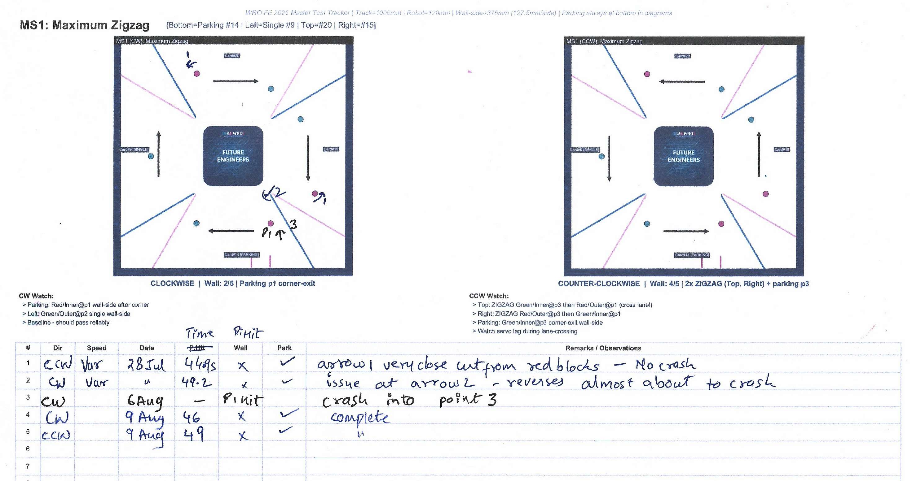
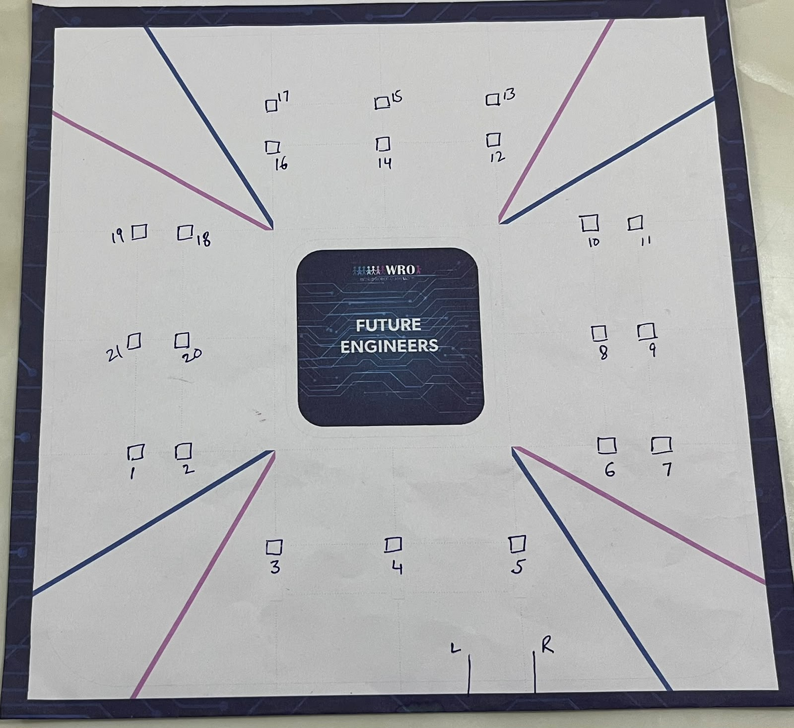
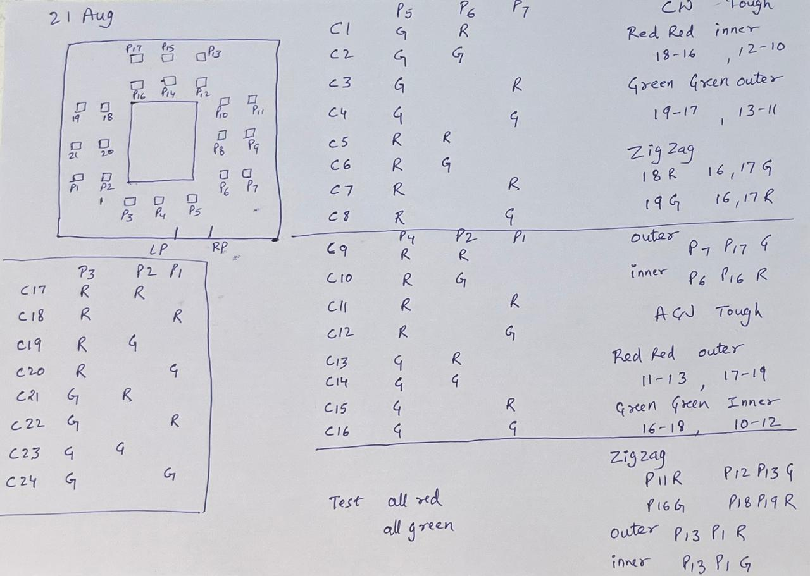
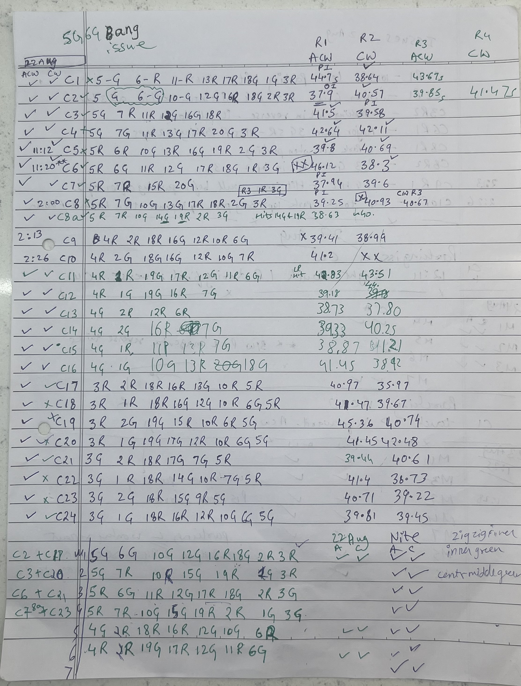
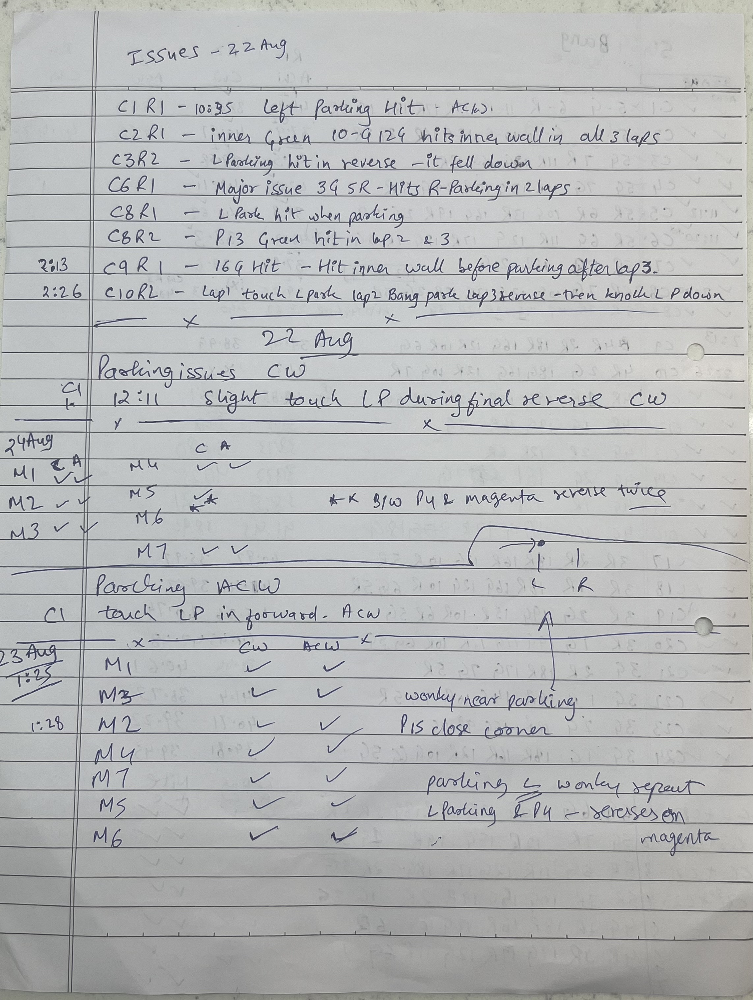

# Field Test Data — Phase 1, Phase 2 and Phase 3

This file holds the typed test data for all three field-testing phases referenced in [`Section_4.9`](../../README.md): Phase 1 (MS1–MS6), Phase 2 (C1–C24) and Phase 3 (M1–M7). It is a data reference only — the reasoning behind why each phase was run is in the main document; this file covers layouts, run data and issues.

## Phase 1 — MS1 to MS6 (28 Jul – 9 Aug)

Six hand-picked hard layouts, generated by [`generate_tough_configs.py`](../scripts/generate_tough_configs.py). Diagrams for all six (CW and CCW) are in [`master_test_layouts/phase1/`](../master_test_layouts/phase1/); the full run sheet is [`WRO_FE_2026_Master_Test_Tracker_v2.pdf`](../master_test_layouts/phase1/WRO_FE_2026_Master_Test_Tracker_v2.pdf). Test Results were recorded on prints of the Test Tracker. One Sample has been shown below.

**MS1 — "Maximum Zigzag"** 

| # | Direction | Date | Time | Wall contact | Parked | Remarks |
|---|---|---|---|---|---|---|
| 1 | CCW | 28 Jul | 44.9s | ✗ (none) | ✓ | Arrow 1: very close cut from red blocks — no crash |
| 2 | CW | 28 Jul | 49.2s | ✗ (none) | ✓ | Issue at arrow 2 — reverses, almost about to crash |
| 3 | CW | 6 Aug | — (no time, run not completed) | pillar 1 hit | — | Crash into point 3 |
| 4 | CW | 9 Aug | 46s | ✗ (none) | ✓ | Complete |
| 5 | CCW | 9 Aug | 49s | ✗ (none) | ✓ | Complete |

MS2–MS6 were tested the same way and total runs across all six scenarios in both directions was 24 runs.

---

## Phase 2 — C1 to C24 (21–22 Aug testing round, 22 Aug fix verification)

### Seat numbering and the 24 combinations

All 21 pillar seats were numbered on a printed field (see image below) and kept beside us while testing. A pillar at seat 4 forces seats 3 and 5 empty; seats 3 and 5 can appear alone or together in any colours. This splits the start into three groups, each given eight layouts (see image below):

| Exit Pillar | Color | Adjacent pillar | Layouts | Count |
|---|---|---|---|---|
| P5 | 5G or 5R | P6 (R\G) , P7 (R\G) | C1–C8 | 8 |
| P4 | 4G or 4R | P1 (R\G) , P2 (R\G) | C9–C16 | 8 |
| P3 | 3G or 3R | P1 (R\G) , P2 (R\G) | C17–C24 | 8 |

<table>
<tr>
<td> </td>
<td></td>
</tr>
<tr>
<td>Printed playfield with 21 pillar seats numbered by hand</td>
<td>Handwritten derivation of the 24 combinations </td>
</table>

### Layouts

| ID | Start pattern | Full layout as tested |
|---|---|---|
| C1 | 5G 6R | 5G 6R 11R 13R 17R 18G 1G 3R |
| C2 | 5G 6G | 5G 6G 10G 12G 16R 18G 2R 3R |
| C3 | 5G 7R | 5G 7R 11R 12G 16G 18R |
| C4 | 5G 7G | 5G 7G 11R 13G 17R 20G 3R |
| C5 | 5R 6R | 5R 6R 10G 13R 16G 19R 2G 3R |
| C6 | 5R 6G | 5R 6G 11R 12G 17R 18G 1R 3G |
| C7 | 5R 7R | 5R 7R 15R 20G |
| C8 | 5R 7G | 5R 7G 10G 13G 17R 18R 2G 3R |
| C8a | 5R 7R | 5R 7R 10G 14G 19R 2R 3G |
| C9 | 4R 2R | 4R 2R 18R 16R 12R 10R 6G |
| C10 | 4R 2G | 4R 2G 18G 16G 12R 10G 7R |
| C11 | 4R 2R | 4R 2R 19G 17R 12G 11R 6G |
| C12 | 4R 1G | 4R 1G 19G 16R 7G |
| C13 | 4G 2R | 4G 2R 12R 6R |
| C14 | 4G 2G | 4G 2G 16R 7G |
| C15 | 4G 1R | 4G 1R 11R 13R 7G |
| C16 | 4G 1G | 4G 1G 10G 13R 20G 18G |
| C17 | 3R 2R | 3R 2R 18R 16R 13G 10R 5R |
| C18 | 3R 1R | 3R 1R 18R 16G 12G 10R 6G 5R |
| C19 | 3R 2G | 3R 2G 19G 15R 10R 6R 5G |
| C20 | 3R 1G | 3R 1G 19G 17G 12R 10R 6G 5G |
| C21 | 3G 2R | 3G 2R 18R 17G 7G 5R |
| C22 | 3G 1R | 3G 1R 18R 14G 10R 7G 5R |
| C23 | 3G 2G | 3G 2G 18R 15G 9R 5G |
| C24 | 3G 1G | 3G 1G 18R 16R 12R 10G 6G 5G |

### Run log — 21–22 August testing round

Handwritten Test run logs are as below for phases 2 and 3 :

<table>
<tr>
<td></td>
<td></td>
</tr>
<tr>
<td align="center"><em>Full layout and run times for all 24 combinations, 21–22 August.</em></td>
<td align="center"><em>Defects from the first testing round, and the fix re-verification pass.</em></td>
</tr>
</table>

Times are for one full round — three laps plus parking — in seconds. `R1`/`R3` are anti-clockwise (ACW) runs, `R2`/`R4` are clockwise (CW) runs. A blank means that run was not attempted. `fail` means the run did not finish cleanly and is crossed out on the sheet. R3/R4 are re-runs, attempted only for combinations that failed on R1/R2.

| ID | R1 (ACW) | R2 (CW) | R3 / R4 | Result |
|---|---|---|---|---|
| C1 | fail (partial impact, PI) | 38.64 ✓ | R3 43.67s | ACW failed, CW and re-run passed |
| C2 | 37.9 (outer impact, OI) | 40.57 | R3 39.85s, R4 41.47s | Ran clean times but with wall contact — see issues |
| C3 | 41.5 ✓ | fail | | ACW passed, CW failed |
| C4 | 42.64 ✓ | 42.11 ✓ | | Both directions clean |
| C5 | 39.8 ✓ (11:12) | 40.69 | | Both directions clean |
| C6 | fail (PI) (11:20) | 38.3 ✓ | | ACW failed, CW passed |
| C7 | 37.94 (PI) | 39.6 ✓ | R3 re-run as 1R 3G | ACW had partial impact; re-run swapped seats 1/3 |
| C8 | 39.25 (PI) | fail (CW, R3) | R3 40.67 | R1 clean-ish, R2 failed, R3 re-run passed |
| C8a | 38.63 | ~40 ("40o") | | Variant of C8, same parking-side seats |
| C9 | fail (2:13) | 38.99, marked 39.41 | | ACW failed |
| C10 | 41.2 | fail (2:26) | | CW failed on parking |
| C11 | 42.83 (LP hit) | 43.51 | | Left-parking contact on R1 |
| C12 | 39.18 | 39.78 (also read 44) | | Both directions clean |
| C13 | 38.73 | 37.80 | | Both directions clean |
| C14 | 39.33 | 40.25 | | Both directions clean |
| C15 | 38.87 | 41.21 | | Both directions clean |
| C16 | 41.45 | 38.92 | | Both directions clean |
| C17 | 40.97 | 35.97 | | Both directions clean |
| C18 | 41.47 | 39.67 | | Both directions clean |
| C19 | 45.36 | 40.74 | | Both directions clean |
| C20 | 41.45 | 42.48 | | Both directions clean |
| C21 | 39.44 | 40.61 | | Both directions clean |
| C22 | 41.4 | 36.73 | | Both directions clean |
| C23 | 40.71 | 39.22 | | Both directions clean |
| C24 | 39.81 | 39.45 | | Both directions clean |

### Issues logged — 21–22 August testing round

| ID | Run | Time noted | Issue |
|---|---|---|---|
| C1 | R1, ACW | 10:35 | Hit the left parking marker |
| C2 | R1 | | Hit the inner wall in all three laps |
| C3 | R2 | | Hit the left parking marker while reversing; it fell over |
| C6 | R1 | | Hit the right parking marker in two laps |
| C8 | R1 | | Hit the left parking marker while parking |
| C8 | R2 | | Hit the green pillar at seat 13 in laps 2 and 3 |
| C9 | R1 | 2:13 | Hit the green pillar at seat 16, then the inner wall before parking |
| C10 | R2 | 2:26 | Touched the left parking marker in lap 1, hit it in lap 2, reversed into it in lap 3 and knocked it down |

### Fix verification — 22 August (tick/cross retest)

Marked directly on the sheet as ✓ (pass) / ✗ (fail) per direction, plus two specific parking notes.

**Parking issues, CW direction**

| ID | Time | Note |
|---|---|---|
| C1 | 12:11 | Slight touch on left parking marker during final reverse (CW) — recorded as ✓ after re-check |

**Parking issues, ACW direction**

| ID | Note |
|---|---|
| C1 | Touch on left parking marker in forward approach (ACW) |

**ACW / CW pass-fail marks, full C1–C24 grid:**

| ID | ACW | CW | ID | ACW | CW | ID | ACW | CW |
|---|---|---|---|---|---|---|---|---|
| C1 | ✓ | ✓ | C9 | ✓ | ✓ | C17 | ✓ | ✓ |
| C2 | ✓ | ✓ | C10 | ✓ | ✓ | C18 | ✓ | ✗ |
| C3 | ✓ | ✓ | C11 | ✓ | ✓ | C19 | ✓ | ✗ |
| C4 | ✓ | ✓ | C12 | ✓ | ✓ | C20 | ✓ | ✗ |
| C5 | ✓ | ✓ | C13 | ✓ | ✓ | C21 | ✓ | ✓ |
| C6 | ✓ | ✓ | C14 | ✓ | ✓ | C22 | ✓ | ✗ |
| C7 | ✓ | ✓ | C15 | ✓ | ✓ | C23 | ✓ | ✗ |
| C8 | ✓ | ✓ | C16 | ✓ | ✓ | C24 | ✓ | ✓ |
| C8a | ✓ | ✓ |||||||

C9 and C10 have no tick/cross recorded on the sheet for this pass but have time mentioned and these cases are passed. C18, C19, C20, C22 and C23 failed CW on this retest — these are the four combinations later paired into M1, M3, M5 and M6 for the merge (C20→M1, C23→M3, C17→M5, C21→M6), plus C18/C19/C22 which were folded into the seat-pattern groups rather than carried forward individually and re-tested there.

---

## Phase 3 — M1 to M7 (22–24 Aug)

### Layouts

The pairings written on the sheet are C2+C17, C3+C20, C6+C21 and C7+C23. M4 and M7 come from the seat-4 group, which were tough combinations. Layout names and their field arrangement pillar strings come from [`../input_config/pillar_configs_input.txt`](../input_config/pillar_configs_input.txt). Final Layouts were numbered as per the optimization script, but the run logs were numbered based on original combinations for 22 Aug and new combinations from 23 and 24 aug.

| Layout | Pillar string | Built from |
|---|---|---|
| M1 | 5G 7R 10R 15G 19R 1G 3R | C3 + C20 |
| M2 | 5G 7R 10G 15R 18R 1G 3R | seat-5 group, alternate inner/outer mix |
| M3 | 5R 7R 10G 15G 18R 2G 3G | C7 + C23 |
| M4 | 4G 2R 18R 16R 12G 10G 6R | seat-4 group |
| M5 | 5G 6G 10G 12G 16R 18G 2R 3R | C2 + C17 — the C2 start pattern is unchanged, this was the worst case |
| M6 | 5R 6G 11R 12G 17R 18G 2R 3G | C6 + C21 |
| M7 | 4R 2R 19G 17R 12G 11R 6G | seat-4 group |

### Run log — 22 August, night (first merge test)

Recorded on the run sheet as rows M1-M6 with "22 Aug / Nite" A(ACW)/C(CW) tick columns

| Merged group | Built from | ACW | CW | Note |
|---|---|---|---|---|
| M1 | C2 + C17 | ✓ | ✓ | Zig-zag pattern flagged near inner green pillars |
| M2 | C3 + C20 | ✓ | ✓ | Centre-middle green pillar flagged |
| M3 | C6 + C21 | ✓ | ✓ | |
| M4 | C7 + C23 | ✓ | ✓ | |
| M5 | seat-4 group | ✓ | ✓ | |
| M6 | seat-4/5 group | ✓ | ✓ | |
| M7 | | - | - |this was defined in later iterations |

**Note on dating:** the same sheet was reused across several sessions and filled wherever space was free, rather than kept strictly top-to-bottom by date. This run log tries to simplify it by recording all data.

### Run log — 23 August, afternoon (full retest)

Timestamped 1:25 and 1:28 on the sheet, both directions ticked.

| ID | CW | ACW | Note |
|---|---|---|---|
| M1 | ✓ | ✓ | (session start 1:25) |
| M3 | ✓ | ✓ | Wonky near parking |
| M2 | ✓ | ✓ | (1:28) P15 close to corner |
| M4 | ✓ | ✓ | |
| M7 | ✓ | ✓ | Parking wonky, repeated |
| M5 | ✓ | ✓ | Left parking marker and P4 — reverses on the magenta parking line |
| M6 | ✓ | ✓ | |

### Run log — 24 August (final run)

Carried on the same run-sheet page, all 7 Optimized Layouts were re-confirmed clean in both directions.

| Layout | Result |
|---|---|
| M1 (C3+C20) | Confirmed clean, both directions |
| M2 | Confirmed clean, both directions |
| M3 (C7+C23) | Confirmed clean, both directions |
| M4 | Confirmed clean, both directions |
| M5 (C2+C17) | Confirmed clean, both directions |
| M6 (C6+C21) | Confirmed clean, both directions |
| M7 | Confirmed clean, both directions |
